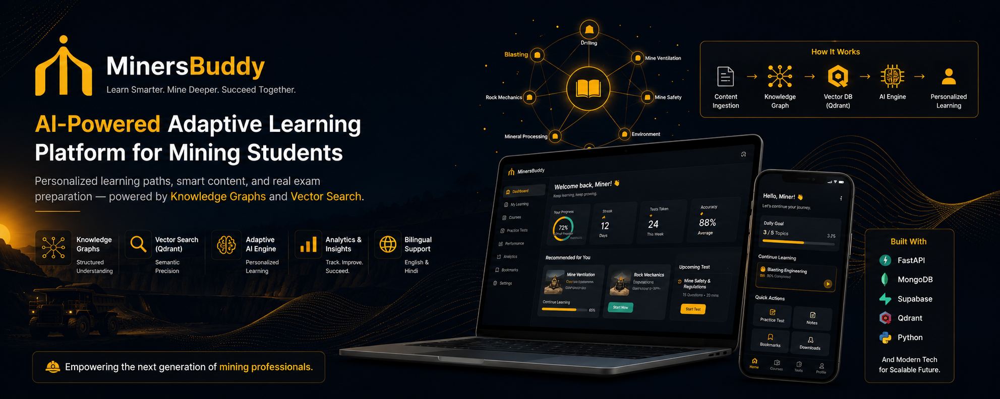
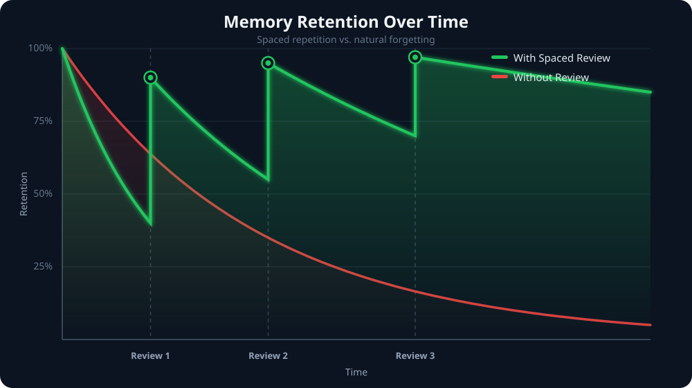
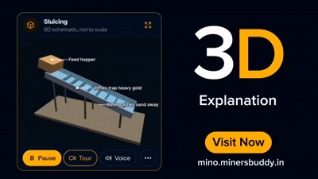

## 👋 Who We Are

We're the technology team behind **[MinersBuddy](https://minersbuddy.in)**, an AI-powered learning platform that gives every mining student a smarter, more structured way to prepare for their **DGMS certifications**.

This account is where that platform gets built, piece by piece.

## 🌟 Our Vision

> A mining student anywhere, from a small town to a big city, should get the same quality of exam preparation as anyone else.

Good preparation shouldn't depend on scattered PDFs, outdated guides, or guesswork. MinersBuddy turns that chaos into **one clear, guided path**, and this team is the engine that makes it real.

---

## 🧠 What Makes It Smart

MinersBuddy isn't static content. It adapts to you.

| | |
|---|---|
| 🎯 **Personalized Prep** Learns what you know and don't, and adjusts what it shows you. | 🔍 **Search That Understands You** Find what you need by meaning, not just exact keywords. |
| 🧩 **Content You Can Trust** Every question and explanation is grounded in real regulations and past papers. No vague or made-up answers. | ⏰ **Revise at the Right Time** Smart reminders surface topics right before you'd naturally forget them. Not too early, not too late. |

📈 **A profile that grows with you:** the more you practice, the sharper your recommendations get. Weak areas get more attention, strong areas stay fresh.

## ⚙️ Under the Hood

  
  
How content connects, and how we time every revision so it actually sticks.

---

## 🎮 Meet Mino: Interactive 3D Learning

  
  
Explore complex mining concepts through interactive 3D models, multi-angle visualization, and guided explanations.

  
<b>👆 Click the animation to experience Mino.</b>

---

## 🚧 Project Status

| Area | Status |
|---|---|
| 🌐 Core Web Platform | ✅ Live |
| 🧠 Smart Content & Test Engine | 🔨 Building |
| 📱 Mobile App (Android & iOS) | 🔨 Building |
| 📊 Personalized Analytics | 🔨 Building |
| 🔁 Continuous Improvements | 🟢 Ongoing |

We're early and building fast, and this profile evolves as the product does. The core web platform, where students access content, tests, and progress tracking, is actively maintained with new features shipped continuously.

## ✨ Feature Roadmap

<table>
<tr>
<td valign="top" width="50%">

### 🔨 In Progress

- [ ] Metal Mines (MMR 1961) content
- [ ] Mock Tests & PYQs
- [ ] PDF Library (handbooks, guides, formula sheets)
- [ ] DGMS announcements & circulars
- [ ] Personalized progress analytics
- [ ] Mobile app build

</td>
<td valign="top" width="50%">

### 🕐 Upcoming

- [ ] Coal Mines (CMR 2017) content
- [ ] Downloadable exam syllabus (DGMS & JUT Diploma)
- [ ] Daily regulation tips
- [ ] Exam countdown tracker
- [ ] Dark mode
- [ ] Notification system

</td>
</tr>
</table>

---

## 🛠️ How We Work

Clean commits, iterative shipping, and a product-first mindset. We'd rather ship something useful and improve it than wait for perfect.

## 📬 Connect With Us

 

*Building, one commit at a time, for every miner's success.*

